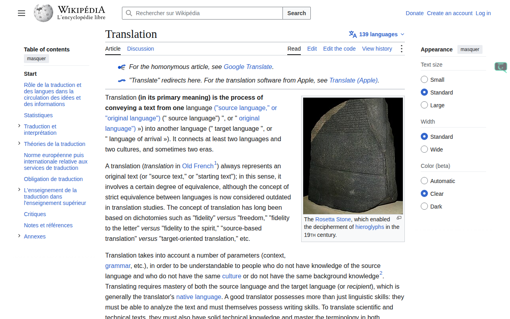
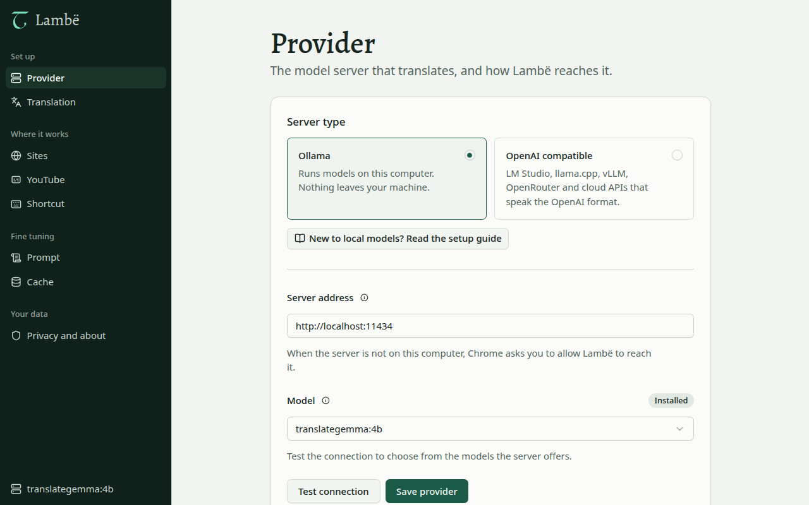
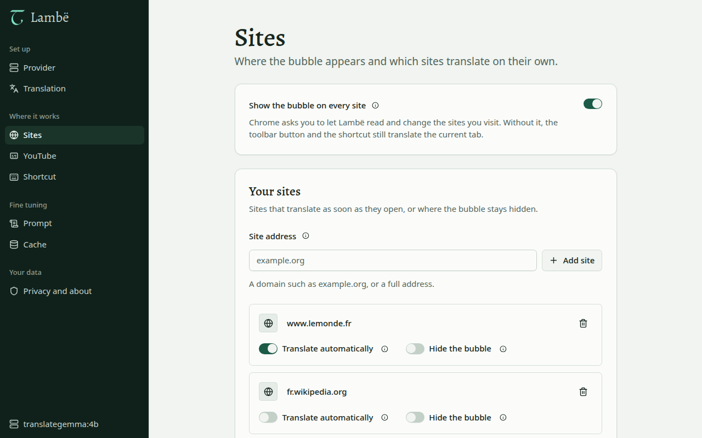
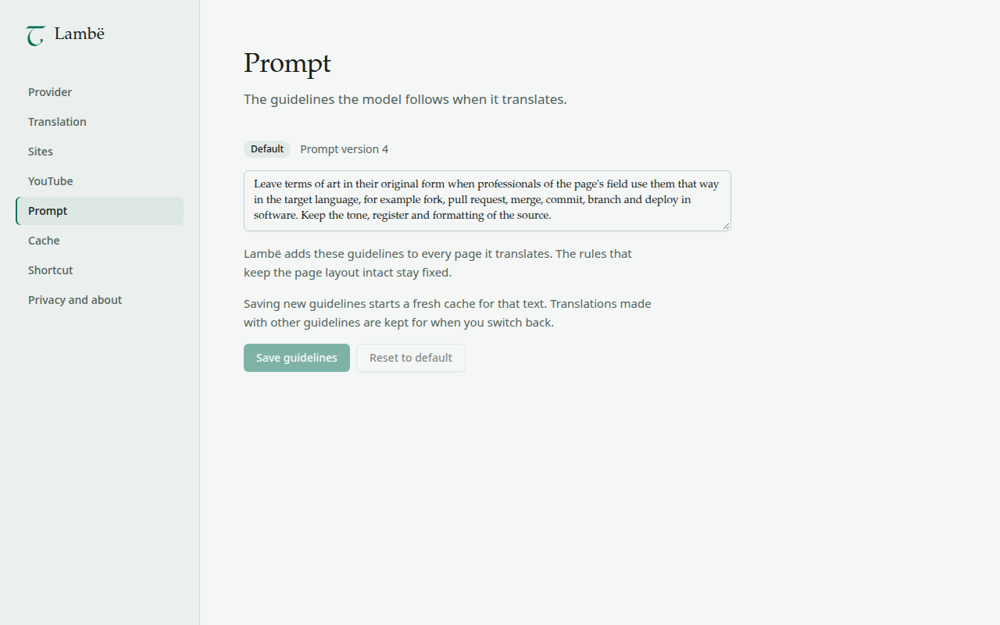
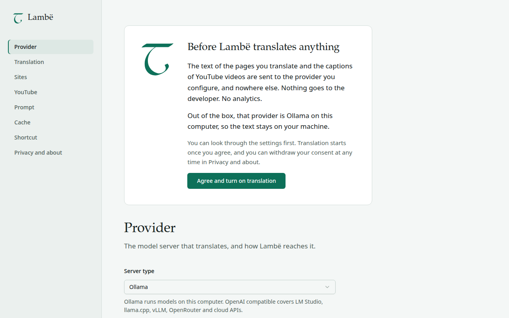

<p align="center">
  
</p>

<h1 align="center">Lambë</h1>

<h3 align="center">Lisez le web dans votre langue, avec un modèle qui vous appartient.</h3>

<p align="center">Une extension Chrome libre et gratuite qui traduit les pages web et les sous-titres YouTube sur place, avec Ollama sur votre ordinateur par défaut. Le texte reste sur votre machine, le code reste intact, et l'original est à un clic.</p>

<p align="center"><a href="README.md">English</a></p>

> [!WARNING]
> **Premiers pas.** Lambë est en `0.x`. Chaque release est une préversion, et les réglages comme le comportement peuvent encore changer. La fiche du Chrome Web Store arrive ; d'ici là, [installez-la depuis une release ou depuis les sources](#démarrage-rapide).

<div align="center">

<table>
  <tr>
    <td>Prouvé par la CI</td>
    <td>
      <a href="https://github.com/axelhamil/lambe/actions/workflows/ci.yml"></a>
      <a href="https://github.com/axelhamil/lambe/actions/workflows/release.yml"></a>
    </td>
  </tr>
  <tr>
    <td>Construit avec</td>
    <td>
      <a href="https://developer.chrome.com/docs/extensions/develop/migrate/what-is-mv3"></a>
      <a href="https://wxt.dev"></a>
      <a href="https://www.typescriptlang.org"></a>
      <a href="https://react.dev"></a>
      <a href="https://ollama.com"></a>
      <a href="https://bun.sh"></a>
      <a href="https://pnpm.io"></a>
    </td>
  </tr>
  <tr>
    <td>Projet</td>
    <td>
      <a href="https://github.com/axelhamil/lambe/releases"></a>
      <a href="LICENSE"></a>
      <a href="docs/privacy-policy.md#français"></a>
      <a href="https://www.conventionalcommits.org"></a>
      <a href="https://github.com/googleapis/release-please"></a>
    </td>
  </tr>
</table>

</div>

<p align="center">
  
</p>

**Lambë** traduit la page que vous lisez sans la quitter, avec le modèle de votre choix : [Ollama](https://ollama.com) sur votre ordinateur par défaut, ou n'importe quel serveur compatible OpenAI. Elle laisse le code intact, garde le jargon métier tel que les professionnels l'écrivent et rétablit l'original instantanément.

Ce qui la distingue :

- **Locale d'abord.** Par défaut elle parle à Ollama sur `localhost` : les pages que vous traduisez ne quittent jamais votre machine. Ni compte, ni abonnement, ni quota.
- **Sur place, et réversible.** Le texte est remplacé là où il est, l'écran visible d'abord. Un clic rétablit l'original depuis la mémoire, à l'identique, sans requête.
- **Elle respecte ce qu'elle lit.** Les blocs de code restent identiques, et les termes du métier (fork, pull request, merge, commit) restent tels que les professionnels les écrivent dans votre langue.
- **YouTube aussi.** Les sous-titres sont traduits quelques phrases avant la tête de lecture, dans un affichage au style de ceux de YouTube.

> [!TIP]
> Jamais fait tourner de modèle sur votre ordinateur ? Le [guide pour faire tourner une IA locale](docs/local-ai.fr.md) ([in English](docs/local-ai.md)) explique le matériel, l'installation, le modèle et les réglages, avec des commandes à copier coller.

## Philosophie

- **Votre texte, votre machine.** Le texte des pages et les sous-titres vont uniquement au fournisseur que vous configurez, et nulle part ailleurs. Rien ne part vers le développeur : ni mesure d'audience, ni code distant, ni traducteur tiers. Les [règles de confidentialité](docs/privacy-policy.md#français) listent chaque donnée que l'extension manipule.
- **Le consentement avant le premier mot.** Tant que vous n'avez pas accepté sur l'écran d'accueil, Lambë n'envoie rien.
- **Le strict nécessaire en autorisations.** L'accès à un site n'est demandé qu'au moment où vous activez une fonction qui en a besoin, et le retirer désactive la fonction.
- **Votre modèle, vos règles.** Vous choisissez le serveur et le modèle, et vous pouvez modifier les consignes que suit le modèle.
- **Libre et gratuite.** Lambë est sous licence MIT, développée au grand jour, libre d'utilisation, de fork et d'amélioration ([contribuer](#contribuer)).

## Aperçu

| | |
|---|---|
|  |  |
| **Fournisseur** : choisir le serveur et le modèle, tester la connexion. | **Sites** : traduire certains sites d'eux-mêmes, masquer la languette sur d'autres. |
|  |  |
| **Prompt** : les consignes que suit le modèle, modifiables. | **Consentement** : rien n'est envoyé avant votre accord. |

## Démarrage rapide

Il vous faut Chrome 130 ou plus récent (ou un navigateur Chromium de même base, comme Brave) et un serveur de modèles. Par défaut, Ollama sur `http://localhost:11434` avec `ollama pull translategemma:12b`.

1. **Faites tourner un modèle.** Installez Ollama et téléchargez le modèle pas à pas avec le [guide pour débutants](docs/local-ai.fr.md).
2. **Installez Lambë**, de l'une de ces trois façons :
   - **Chrome Web Store** : bientôt ; le lien arrive ici dès que la fiche est en ligne.
   - **Depuis une release** : téléchargez le fichier `*-chrome.zip` de la [dernière release](https://github.com/axelhamil/lambe/releases) et décompressez-le.
   - **Depuis les sources** : clonez le dépôt, puis

     ```sh
     pnpm install
     pnpm --filter @lambe/extension build
     ```

   Pour une release ou une compilation, ouvrez `chrome://extensions`, activez le mode développeur, cliquez sur **Charger l'extension non empaquetée** et choisissez le dossier décompressé, ou `apps/extension/.output/chrome-mv3`.
3. **Autorisez Lambë dans Ollama**, qui répond 403 aux origines qu'il ne connaît pas ([plus bas](#autoriser-lextension-dans-ollama)).
4. **Acceptez sur l'écran d'accueil.** La page des réglages s'ouvre à l'installation. Elle explique ce qui sort du navigateur (le texte des pages et les sous-titres que vous traduisez, envoyés uniquement au fournisseur que vous configurez) et demande votre consentement. Tant que vous n'avez pas accepté, Lambë n'envoie rien : l'icône de la barre d'outils, `Alt+L` et la bulle ouvrent les réglages. Vous pouvez retirer votre consentement à tout moment dans **Confidentialité et à propos**.
5. **Traduisez** : appuyez sur `Alt+L` sur n'importe quelle page.

## Utilisation

- Icône de la barre d'outils ou `Alt+L` : traduit la page courante, puis bascule entre la traduction et l'original.
- Clic sur la languette : traduit la partie visible de la page, puis ce que vous faites défiler.
- Nouveau clic : retour à l'original, depuis la mémoire, sans requête. Encore un : la traduction revient, sans requête.
- Double clic : traduit de nouveau en ignorant le cache, qui est réécrit.
- Glisser la languette vers le haut ou le bas : elle reste accrochée au bord droit, dans la fenêtre, là où vous la laissez.
- Clic droit sur la languette, ou touche menu quand elle a le focus : traduire cette page dans une autre langue, traduire ce site automatiquement, masquer la languette sur ce site ou ouvrir les réglages.

## Réglages

| Section | Ce que vous réglez |
| --- | --- |
| Fournisseur | Ollama ou compatible OpenAI, URL de base, modèle (choisi dans la liste du serveur), clé d'API pour le compatible OpenAI, et un test de connexion qui explique chaque échec |
| Traduction | La langue cible, par défaut celle du navigateur |
| Sites | La languette sur tous les sites, et des règles par site : traduction automatique, languette masquée |
| YouTube | Les sous-titres traduits dans le lecteur |
| Prompt | Les consignes que suit le modèle ; les modifier repart d'un cache neuf pour ce texte, la réinitialisation rétablit celles par défaut |
| Cache | La taille des traductions gardées sur l'appareil, et un bouton pour le vider |
| Raccourci | La touche actuelle de la commande de bascule (`Alt+L` par défaut) et un lien pour la changer |
| Confidentialité et à propos | Ce qui est envoyé et où, le consentement, la version, les règles de confidentialité |

Les réglages sont dans `chrome.storage.local` sous `lambe:settings` ; la clé d'API est rangée à part sous `lambe:secrets` et n'apparaît jamais dans les journaux. Si les réglages enregistrés sont invalides ou viennent d'une version plus récente, Lambë tourne avec les valeurs par défaut, n'y touche pas et affiche un bandeau pour les réinitialiser ou les corriger.

## Fournisseurs

- **Ollama** (par défaut) : `http://localhost:11434`, modèles lus depuis `/api/tags`. Voir [Autoriser l'extension dans Ollama](#autoriser-lextension-dans-ollama).
- **Compatible OpenAI** : tout serveur qui parle `POST /v1/chat/completions` en streaming et `GET /v1/models` (LM Studio, vLLM, serveur llama.cpp, API hébergées). Saisissez l'URL de base avec ou sans `/v1`, et la clé d'API si le serveur en demande une. Enregistrer une URL de base hors de `localhost` demande à Chrome l'accès à cette seule origine.

Les requêtes vers le fournisseur partent du service worker ou de la page des réglages, jamais d'un script de contenu.

## Autoriser l'extension dans Ollama

Ollama répond 403 aux origines qu'il ne connaît pas. La languette passe alors au gris, et le test de connexion des réglages affiche la correction pour Linux, macOS et Windows avec l'identifiant de l'extension en cours. Sous Linux, lancez `sudo systemctl edit ollama`, puis ajoutez :

```ini
[Service]
Environment="OLLAMA_ORIGINS=chrome-extension://dccgcoohbalgmgkflpndagoallbcgnch"
```

Enregistrez, puis lancez `sudo systemctl restart ollama`. Avec la version du store, utilisez son identifiant à la place. macOS et Windows sont décrits dans le [guide pour débutants](docs/local-ai.fr.md#3-autoriser-lambë-à-parler-à-ollama).

### Facultatif : requêtes en parallèle

Rien d'autre n'est requis. Lambë garde une requête en attente derrière celle qui arrive, pour que le GPU n'attende jamais, et demande à Ollama de garder le modèle chargé 10 minutes (`keep_alive`). Si vous ajoutez aussi `Environment="OLLAMA_NUM_PARALLEL=4"` dans le même bloc `[Service]`, Lambë voit les réponses arriver en parallèle, monte jusqu'à 8 requêtes simultanées et répartit l'écran visible entre elles. Sans ce réglage, Lambë reste à 1 requête à la fois. Le parallélisme appris est partagé par tous les onglets et gardé les mêmes 10 minutes après la dernière réponse, puis Lambë repart de 1.

## Sous-titres YouTube

YouTube est activé par défaut : Chrome demande l'accès aux sites, `https://www.youtube.com/*` compris, quand vous acceptez sur l'écran d'accueil, ou plus tard depuis le réglage YouTube. Sur une page de vidéo, Lambë ajoute alors un bouton aux commandes du lecteur, à gauche du bouton des sous-titres. Un clic affiche les sous-titres traduits dans la langue cible, avec le style de ceux de YouTube ; les sous-titres natifs sont masqués, et activés s'ils étaient coupés. Un nouveau clic rétablit les sous-titres natifs tels que vous les aviez, sans requête ; encore un et la traduction revient, sans requête non plus. Couper les sous-titres dans le lecteur coupe aussi Lambë. Lambë lit la piste que le lecteur charge lui-même et ne demande au modèle que quelques phrases d'avance sur la tête de lecture : l'avance rapide et la navigation dans YouTube marchent sans rechargement. Une piste déjà dans la langue cible s'affiche telle quelle, sans requête.

## Confidentialité et autorisations

Lambë demande le strict nécessaire et réclame le reste au moment où vous activez une fonction. Ce qu'elle stocke, où vont les données et comment les supprimer : voir les [règles de confidentialité](docs/privacy-policy.md#français).

| Autorisation | Pourquoi |
| --- | --- |
| `storage`, `unlimitedStorage` | Les réglages, la clé d'API facultative et le cache des traductions, sur l'appareil uniquement |
| `activeTab`, `scripting` | Injecter le script de page dans l'onglet courant quand vous cliquez sur l'icône ou appuyez sur `Alt+L` |
| `http://localhost/*`, `http://127.0.0.1/*` | Joindre Ollama sur votre ordinateur, sur n'importe quel port |
| `https://*/*`, `http://*/*` (facultatives) | Demandées au moment du clic pour ce que vous choisissez : la languette partout, un site traduit automatiquement, les sous-titres YouTube, un fournisseur distant |

Le manifeste ne déclare aucun script de contenu. La languette partout, la traduction automatique d'un site et les sous-titres YouTube enregistrent leurs scripts à l'exécution, une fois l'origine accordée. Retirer une origine dans `chrome://extensions` supprime ses scripts et désactive le réglage.

## Langues

L'interface suit la langue du navigateur, français ou anglais (`apps/extension/locales`). Une chaîne française manquante retombe sur l'anglais, et un test échoue dès que les deux catalogues divergent.

## Identifiant de l'extension

Le manifeste porte une `key` publique fixe (dans `apps/extension/wxt.config.ts`) : l'identifiant de la version non empaquetée est le même sur toutes les machines, `dccgcoohbalgmgkflpndagoallbcgnch`. Pour le retrouver depuis une compilation :

```sh
jq -r .key apps/extension/.output/chrome-mv3/manifest.json | base64 -d | sha256sum | head -c32 | tr 0-9a-f a-p
```

La clé privée n'est jamais versionnée. La version du store n'a pas de `key` : le Chrome Web Store attribue son propre identifiant.

## Développement

Il vous faut Node 24.22.1 ou plus récent (`.nvmrc`), pnpm 12 (`packageManager`) et Bun 1.4.4 pour les tests et les scripts (`.bun-version`, lu aussi par la CI).

| Commande | Rôle |
| --- | --- |
| `pnpm verify` | Biome, vérification des types, tests, knip, jscpd, dependency-cruiser |
| `pnpm test` | Tests Bun de chaque workspace |
| `pnpm fix` | Biome avec corrections |
| `pnpm zip` | Zip pour le store dans `apps/extension/.output/*-chrome-store.zip`, compilé avec `LAMBE_STORE=1` (sans `key`) |
| `pnpm --filter @lambe/extension build` | Compilation de production dans `apps/extension/.output/chrome-mv3` |
| `pnpm --filter @lambe/extension dev` | Mode développement WXT |
| `pnpm --filter @lambe/extension fixtures` | Sert les fixtures et les pages de preuve sur `http://localhost:4173` |
| `bun apps/extension/scripts/render-promo.ts` | Génère la vignette promotionnelle 440x280 avec Brave headless (`BRAVE_PATH` pour un autre Chromium) |

```text
apps/extension/         l'extension WXT : service worker, scripts de page et de YouTube,
                        page des réglages (React), languette, langues (en, fr), pages de preuve
packages/translation/   le moteur sans framework : segmentation, prompts, lots, file,
                        politique de cache, fournisseurs, adaptateurs DOM et YouTube, fixtures
packages/kernel/        Result, Option et value objects, partagés par les autres paquets
tooling/                plugins Biome et scripts de CI (tooling/ci/)
docs/                   guides, règles de confidentialité, fiche du store, conception et plans
```

**Fixtures.** `packages/translation/fixtures` contient des pages enregistrées pour les tests du DOM et la preuve dans le navigateur. `github-fork-a-repo.html` reprend un contenu de GitHub Docs sous CC BY 4.0 ; sa source et les modifications sont listées dans `packages/translation/fixtures/README.md`. `apps/extension/proof` contient `proof.html` (la fixture dans des cadres de 390, 768 et 1440 px) et `strict-csp.html`, servie avec une `Content-Security-Policy` stricte. Ce que chaque plan a mesuré dans un vrai navigateur est dans [docs/verification.md](docs/verification.md) (en anglais).

## Chrome Web Store

- Texte de la fiche, objectif unique, justification des autorisations et déclarations sur les données : [`docs/store/listing.fr.md`](docs/store/listing.fr.md) et [`docs/store/listing.en.md`](docs/store/listing.en.md). Un test vérifie que les descriptions courtes tiennent en 132 caractères et que chaque autorisation du manifeste est justifiée, sans en ajouter.
- Vignette promotionnelle et captures : `docs/store/assets/`.
- Règles de confidentialité : [`docs/privacy-policy.md`](docs/privacy-policy.md). La fiche et les réglages pointent vers ce fichier sur GitHub.
- Version du store : `pnpm zip`, puis `LAMBE_STORE=1 pnpm --filter @lambe/extension check:manifest` pour vérifier qu'elle n'a ni `key` ni script de contenu statique, et exactement les autorisations prévues.
- Publication automatique et configuration initiale : [`docs/store/publishing.fr.md`](docs/store/publishing.fr.md).

## Documentation

[docs/README.md](docs/README.md) liste toutes les pages. Par où commencer :

| Lire | Quand vous voulez |
|---|---|
| [guide de l'IA locale](docs/local-ai.fr.md) ([en](docs/local-ai.md)) | faire tourner un modèle sur votre ordinateur et y connecter Lambë, sans coder |
| [règles de confidentialité](docs/privacy-policy.md#français) | savoir ce que Lambë manipule, où cela va et comment le supprimer |
| [vérification](docs/verification.md) | voir ce que chaque plan a mesuré dans un vrai navigateur |
| [releases](docs/maintenance/releases.md) | comprendre comment une PR fusionnée devient une release sur le store |
| [publication sur le store](docs/store/publishing.fr.md) | configurer l'envoi au Chrome Web Store |

## Releases

Les versions viennent des Conventional Commits, par [release-please](https://github.com/googleapis/release-please). Le travail arrive sur `develop` ; release-please y tient une PR de release, et la fusionner crée le tag, avance `main` jusqu'à la release, joint les zips non empaqueté et du store à la release GitHub et envoie le zip du store au Chrome Web Store. Lambë reste en `0.x`, chaque release est une préversion, et personne ne fixe une version ou un tag à la main. Le circuit complet et les réglages du dépôt sont dans [docs/maintenance/releases.md](docs/maintenance/releases.md) (en anglais).

## Contribuer

Issues et pull requests sont les bienvenues, en français ou en anglais. Lisez d'abord [CONTRIBUTING.md](CONTRIBUTING.md) : partez de `develop`, lancez `pnpm verify`, vérifiez les changements d'interface dans un vrai navigateur et écrivez des Conventional Commits. Signalez une faille en privé selon [SECURITY.md](SECURITY.md), et lisez le [code de conduite](CODE_OF_CONDUCT.md).

## Licence

[MIT](LICENSE). Lambë est libre et gratuite : utilisez-la, forkez-la, publiez-la.

<sub>D'où vient le nom : Lambë signifie « langue » en quenya ; le glyphe de la languette est le tengwa du même nom.</sub>
